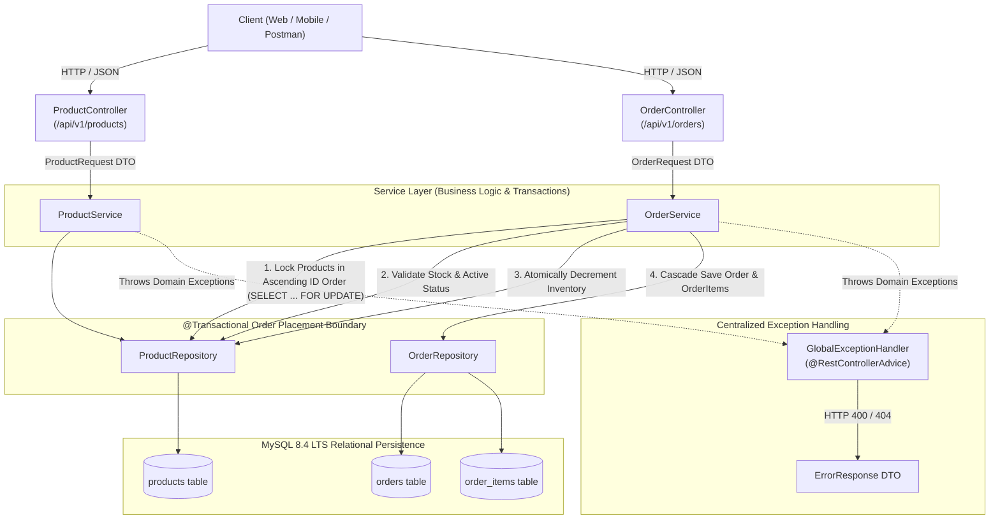
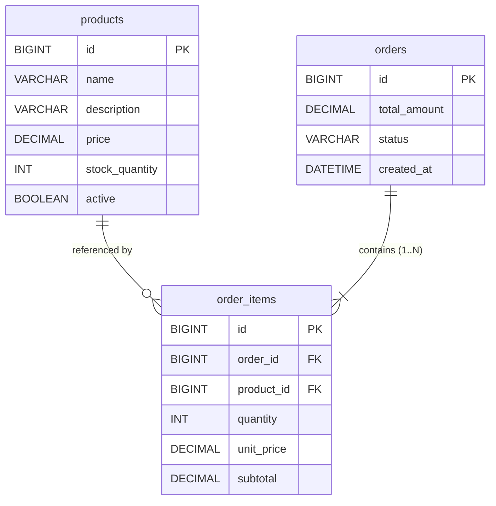

# OrderFlow — E-commerce Order Management System

<p align="center">
  <strong>A transactional, high-concurrency e-commerce order management backend built with Java 21, Spring Boot, and MySQL.</strong>
</p>

<p align="center">
  
  
  
  
  
  
  
</p>

---

## Table of Contents

- [Project Overview](#project-overview)
- [Technology Stack](#technology-stack)
- [Architecture](#architecture)
  - [Layered Architecture Breakdown](#layered-architecture-breakdown)
  - [Component Responsibilities](#component-responsibilities)
  - [Mermaid Architecture Diagram](#mermaid-architecture-diagram)
- [Core Backend Concepts](#core-backend-concepts)
  - [1. ACID Transactions & Rollback Behavior](#1-acid-transactions--rollback-behavior)
  - [2. Pessimistic Locking & Deadlock Reduction](#2-pessimistic-locking--deadlock-reduction)
  - [3. Stock Validation & Inventory Integrity](#3-stock-validation--inventory-integrity)
  - [4. Entity Relationships & Lifecycle Cascades](#4-entity-relationships--lifecycle-cascades)
  - [5. Historical Price Preservation](#5-historical-price-preservation)
- [Database Configuration & Security](#database-configuration--security)
  - [Configuration & Environment Variables](#configuration--environment-variables)
  - [Test Database Isolation](#test-database-isolation)
  - [Hibernate DDL Modes (`update` vs. `create-drop`)](#hibernate-ddl-modes-update-vs-create-drop)
  - [Entity Relationship Diagram & Schema](#entity-relationship-diagram--schema)
- [API Documentation](#api-documentation)
  - [Health Endpoint](#health-endpoint)
  - [Product Management Endpoints](#product-management-endpoints)
  - [Order Management Endpoints](#order-management-endpoints)
  - [Request & Response Examples](#request--response-examples)
- [Automated Testing & Verification](#automated-testing--verification)
  - [Test Suite Breakdown (Latest Verified Result: 65 Passing Tests)](#test-suite-breakdown-latest-verified-result-65-passing-tests)
  - [Testing Methodologies](#testing-methodologies)
- [Project Structure](#project-structure)
- [Setup & Running the Application](#setup--running-the-application)
  - [Prerequisites](#prerequisites)
  - [Database Setup](#database-setup)
  - [Environment Variables](#environment-variables)
  - [Running the Application](#running-the-application)
  - [Running Automated Tests](#running-automated-tests)
  - [Building for Production](#building-for-production)
  - [Manual API Testing with Postman](#manual-api-testing-with-postman)
- [Project Status & Roadmap](#project-status--roadmap)
- [Development & Engineering Principles](#development--engineering-principles)

---

## Project Overview

**OrderFlow** is an e-commerce order management backend system engineered with **Java 21**, **Spring Boot 4.1.2**, and **MySQL 8.4 LTS**. It delivers enterprise-grade operational foundations for online commerce, focusing on data consistency, inventory integrity, and high-concurrency order placement.

The application addresses two critical domain areas:
1. **Product Management**: Complete product lifecycle administration (creation, retrieval, updates, and deletion), inventory tracking, and active/inactive status toggling.
2. **Order Management**: Robust, transactional multi-product checkout workflows, row-level pessimistic concurrency control, deadlock mitigation, immutable `BigDecimal` pricing math, and eager order retrieval.

Key engineering highlights include:
- **Strict Layered Architecture**: Comprehensive separation of concerns across controllers, business services, repositories, domain entities, and data transfer objects (DTOs).
- **ACID Transaction Guarantees**: Complete transactional order execution using Spring's `@Transactional`, ensuring atomic inventory deductions and automatic rollbacks on validation failures.
- **Pessimistic Concurrency Control (`SELECT ... FOR UPDATE`)**: Row-level locking protects product inventory records from overselling during high-concurrency purchase bursts.
- **Deadlock Risk Mitigation**: Deterministic, ascending numerical lock acquisition reduces deadlock risk among transactions locking overlapping product rows in a consistent order.
- **Database Isolation**: Dedicated MySQL schemas for development (`orderflow`) and automated testing (`orderflow_test`), preventing test suite cleanups from affecting development data.
- **Automated Test Suite**: 65 passing tests across unit, web slice, and full database integration layers as the latest verified test result.

---

## Technology Stack

| Layer / Concern | Technology | Version / Specification | Purpose |
| :--- | :--- | :--- | :--- |
| **Language** | **Java** | 21 (LTS) | Core platform utilizing modern LTS language features |
| **Framework** | **Spring Boot** | 4.1.2 | Application core, dependency injection, and auto-configuration |
| **Persistence / ORM** | **Spring Data JPA & Hibernate** | Managed by Spring Boot BOM | Object-Relational Mapping, entity lifecycle, JPQL queries |
| **Database** | **MySQL** | 8.4 LTS | Relational database persistence |
| **Web / REST** | **Spring Web (MVC)** | Managed by Spring Boot BOM | REST routing, HTTP request/response serialization, content negotiation |
| **Validation** | **Jakarta Bean Validation** | Managed by Spring Boot BOM | Declarative payload constraint validation (`@Valid`, `@NotNull`, `@Positive`) |
| **Exception Handling** | **Spring MVC Advice** | `@RestControllerAdvice` | Centralized exception mapping and standard error contract |
| **Build Automation** | **Apache Maven** | 3.9+ (Wrapper included) | Dependency management, compilation, and testing harness |
| **Testing Harness** | **JUnit 5, Mockito & MockMvc** | Managed by Spring Boot BOM | Unit testing, mock verification, and web-layer slice testing |
| **API Testing** | **Postman** | Latest | Manual endpoint verification and exploratory API testing |
| **Security (Planned)** | **Spring Security & JWT** | Managed by Spring Boot BOM | User authentication, token authorization, and RBAC |
| **Caching (Planned)** | **Redis** | 7.x | High-throughput distributed caching and rate limiting |
| **DevOps (Planned)** | **Docker & Docker Compose** | Multi-container setup | Containerized runtime environments |
| **Messaging (Future)** | **Apache Kafka** | Distributed Streaming | Asynchronous order event publishing and event-driven architecture |

---

## Architecture

OrderFlow follows a classic, robust **Layered Architecture**. Each layer maintains strict boundaries, preventing leaky abstractions and ensuring maintainability, testability, and separation of concerns.

```
┌─────────────────────────────────────────────────────────────┐
│              Client (HTTP / JSON / Postman)                 │
└──────────────────────────────┬──────────────────────────────┘
                               │
                               ▼
┌─────────────────────────────────────────────────────────────┐
│                      Controller Layer                       │
│     ProductController  │  OrderController  │  Health        │
│     • Handles REST routing and HTTP status codes            │
│     • Validates incoming JSON payloads with @Valid          │
│     • Maps between DTOs and internal domain models          │
└──────────────────────────────┬──────────────────────────────┘
                               │
                               ▼
┌─────────────────────────────────────────────────────────────┐
│                       Service Layer                         │
│             ProductService  │  OrderService                 │
│     • Enforces domain validation & business invariants      │
│     • Coordinates @Transactional boundaries & rollback rules│
│     • Ascending-ID lock sorting reduces deadlock risk      │
│     • Performs precise financial math using BigDecimal      │
└──────────────────────────────┬──────────────────────────────┘
                               │
                               ▼
┌─────────────────────────────────────────────────────────────┐
│                      Repository Layer                       │
│           ProductRepository  │  OrderRepository             │
│     • Spring Data JPA abstraction & custom JPQL queries     │
│     • Pessimistic Row Locking (SELECT ... FOR UPDATE)       │
│     • Eager retrieval via JOIN FETCH (prevents N+1 queries) │
└──────────────────────────────┬──────────────────────────────┘
                               │
                               ▼
┌─────────────────────────────────────────────────────────────┐
│                   MySQL 8.4 LTS Database                    │
│     Dev: orderflow  │  Test: orderflow_test                 │
│     Tables: products  │  orders  │  order_items             │
└─────────────────────────────────────────────────────────────┘
```

### Layered Architecture Breakdown

1. **Controller Layer (`com.orderflow.orderflow.controller`)**:
   - Exposes REST endpoints under `/api/v1/products`, `/api/v1/orders`, and `/api/v1/health`.
   - Validates incoming request payloads using Jakarta Bean Validation (`@Valid`).
   - Delegates business operations directly to the service layer.
   - Converts internal entity objects to response DTOs, ensuring domain entities are never exposed across the network boundary.
   - Returns appropriate HTTP status codes (`200 OK`, `201 Created`, `204 No Content`, `400 Bad Request`, `404 Not Found`).

2. **Service Layer (`com.orderflow.orderflow.service`)**:
   - Houses domain business logic, validations, and state transitions.
   - Manages transactional boundaries using Spring's `@Transactional`.
   - Enforces inventory checks (`stockQuantity >= requestedQuantity`) and active status checks (`Boolean.TRUE.equals(product.getActive())`).
   - Sorts product IDs in ascending numerical order before acquiring pessimistic locks to minimize deadlock risk.
   - Calculates line item subtotals and overall order totals using immutable `BigDecimal` arithmetic.

3. **Repository Layer (`com.orderflow.orderflow.repository`)**:
   - Spring Data JPA interfaces extending `JpaRepository<T, ID>`.
   - Encapsulates database queries, custom JPQL queries, and database-level lock acquisition.
   - `ProductRepository`: Provides `findByIdWithPessimisticLock(Long id)` using `@Lock(LockModeType.PESSIMISTIC_WRITE)`.
   - `OrderRepository`: Provides `findByIdWithItems(Long id)` using `LEFT JOIN FETCH` to eagerly load order items and associated product metadata in a single query.

4. **Model / Entity Layer (`com.orderflow.orderflow.model`)**:
   - JPA entities (`Product`, `Order`, `OrderItem`, `OrderStatus`) mapping directly to relational database tables.
   - Manages relationship mappings (`@OneToMany`, `@ManyToOne`) with helper synchronization method (`order.addOrderItem()`) to maintain bidirectional referential integrity in memory.

5. **DTO Layer (`com.orderflow.orderflow.dto`)**:
   - Defines strict client-facing contracts (`ProductRequest`, `ProductResponse`, `OrderRequest`, `OrderItemRequest`, `OrderResponse`, `OrderItemResponse`, `ErrorResponse`).
   - Insulates internal database schemas from external API consumers, shielding against over-posting and mass-assignment vulnerabilities.

6. **Exception Handling Layer (`com.orderflow.orderflow.exception`)**:
   - Centralized `@RestControllerAdvice` (`GlobalExceptionHandler`) intercepting domain exceptions and validation errors.
   - Translates exceptions into standardized, client-friendly `ErrorResponse` payloads with uniform HTTP status codes.

### Component Responsibilities

| Component | Responsibility | Examples |
| :--- | :--- | :--- |
| **Controller** | HTTP routing, request parsing, payload validation, DTO transformation | `ProductController`, `OrderController` |
| **Service** | Business rules, transactions, stock deduction, concurrency control, pricing | `ProductService`, `OrderService` |
| **Repository** | Data access, CRUD operations, pessimistic row locks, eager fetch queries | `ProductRepository`, `OrderRepository` |
| **Entity** | Relational state representation, relationship mapping, domain state | `Product`, `Order`, `OrderItem`, `OrderStatus` |
| **DTO** | Public contract definition, boundary validation, entity protection | `ProductRequest`, `OrderRequest`, `OrderResponse` |

### Mermaid Architecture Diagram



---

## Core Backend Concepts

### 1. ACID Transactions & Rollback Behavior

Order placement requires updating multiple records simultaneously: decrementing product inventories, generating line items, and recording the aggregate order. 

`OrderService.placeOrder(OrderRequest)` is annotated with `@Transactional`. This ensures **atomicity**, **consistency**, **isolation**, and **durability**:
- If any requested product is missing, inactive, or has insufficient inventory, a domain exception is thrown (`ProductNotFoundException`, `InactiveProductException`, or `InsufficientStockException`).
- The active transaction immediately marks for rollback.
- Any stock decrements or order line insertions executed prior to the failure within that transaction are fully rolled back by the MySQL database engine.
- No partial orders, orphaned line items, or inconsistent stock levels are ever persisted.

### 2. Pessimistic Locking & Deadlock Reduction

#### Pessimistic Row Locking (`SELECT ... FOR UPDATE`)
In concurrent e-commerce systems, multiple clients may attempt to purchase the final available units of an item simultaneously. Reading stock without locks introduces race conditions where both threads verify available inventory and simultaneously decrement stock, resulting in negative inventory (overselling).

OrderFlow employs **Pessimistic Write Locking** via Spring Data JPA:
```java
@Lock(LockModeType.PESSIMISTIC_WRITE)
@Query("SELECT p FROM Product p WHERE p.id = :id")
Optional<Product> findByIdWithPessimisticLock(@Param("id") Long id);
```
In MySQL with the InnoDB storage engine, this translates to an exclusive `SELECT ... FOR UPDATE` row lock. When Transaction A locks a product row, Transaction B attempting to place an order for the same item must wait until Transaction A commits or rolls back, guaranteeing strictly serialized inventory updates.

#### Deadlock Risk Reduction via Ascending Lock Acquisition
When multi-product orders involve overlapping items, concurrent transactions locking items in different sequences can encounter a **deadlock** (circular wait):
- *Transaction 1* requests Product 10, then Product 5 (locks 10, waits for 5).
- *Transaction 2* requests Product 5, then Product 10 (locks 5, waits for 10).
- Both transactions block indefinitely until the database engine detects the deadlock and aborts one transaction.

OrderFlow resolves this by sorting all product IDs in **strictly ascending numerical order** before acquiring any locks:
```java
List<OrderItemRequest> sortedItemRequests = request.getItems().stream()
        .sorted(Comparator.comparing(OrderItemRequest::getProductId))
        .toList();
```
Because all concurrent transactions acquire row locks in the exact same global order ($ID_1 < ID_2 < \dots < ID_n$), this reduces deadlock risk among transactions locking overlapping product rows in a consistent order under high concurrency.

### 3. Stock Validation & Inventory Integrity

Inventory validations follow a strict defensive verification sequence:
1. **Input Hygiene**: Product IDs must be `@NotNull` and `@Positive`. Quantities must be `@NotNull` and `@Min(1)`. Requests cannot contain duplicate product IDs.
2. **Existence & State**: The product record must exist in the database, and its `active` flag must evaluate to `Boolean.TRUE`. Inactive products are rejected with `InactiveProductException` (HTTP 400).
3. **Inventory Availability**: Available stock must satisfy the condition `availableStock >= requestedQuantity`. If depleted or insufficient, the order fails immediately with `InsufficientStockException` (HTTP 400).
4. **Atomic Decrement**: Stock is reduced (`availableStock - requestedQuantity`) and persisted within the transactional lock boundary.

### 4. Entity Relationships & Lifecycle Cascades

- **Order to OrderItem (`@OneToMany`)**:
  - `Order` functions as the aggregate root, holding a `List<OrderItem> orderItems`.
  - Configured with `cascade = CascadeType.ALL` and `orphanRemoval = true`.
  - Saving an `Order` automatically persists all associated `OrderItem` entities in a single atomic database operation.
  - The helper method `order.addOrderItem(orderItem)` synchronizes both sides of the relationship in memory by setting the parent order reference on the item.
- **OrderItem to Order (`@ManyToOne`)**:
  - Configured with `@JoinColumn(name = "order_id", nullable = false)`.
- **OrderItem to Product (`@ManyToOne`)**:
  - Configured with `@ManyToOne(fetch = FetchType.LAZY)` and `@JoinColumn(name = "product_id", nullable = false)`.
- **Eager Retrieval via `JOIN FETCH`**:
  - `OrderRepository.findByIdWithItems(Long id)` executes:
    ```jpql
    SELECT o FROM Order o 
    LEFT JOIN FETCH o.orderItems oi 
    LEFT JOIN FETCH oi.product 
    WHERE o.id = :id
    ```
  - This retrieves the order, its items, and product details in a single SQL query, preventing `LazyInitializationException` and avoiding the N+1 query problem during order retrieval.

### 5. Historical Price Preservation

A common anti-pattern in e-commerce database design is relying dynamically on `product.price` when computing order history. Product catalog prices fluctuate regularly due to promotions, inflation, or supplier price changes.

If an order placed six months ago recalculated line item subtotals using the current `product.price`, historical accounting, invoices, and customer receipts would be corrupted.

To preserve historical accuracy and audit integrity:
- `OrderService` reads the product's price at checkout directly from the locked `Product` entity.
- The unit price is frozen and explicitly persisted in `order_items.unit_price`.
- Subtotals (`unit_price * quantity`) and order total amounts are computed using immutable `BigDecimal` arithmetic and permanently persisted.
- Client-supplied prices or subtotals are completely ignored.

---

## Database Configuration & Security

### Configuration & Environment Variables

OrderFlow persists data to MySQL 8.4 LTS. To prevent credentials from leaking into source code or Git history, sensitive database credentials are parameterized using environment variable placeholders.

**`src/main/resources/application.properties` (Development)**:
```properties
spring.application.name=orderflow
server.port=8081

# MySQL Database DataSource
spring.datasource.url=jdbc:mysql://localhost:3306/orderflow
spring.datasource.username=root
spring.datasource.password=${SPRING_DATASOURCE_PASSWORD}
spring.datasource.driver-class-name=com.mysql.cj.jdbc.Driver

# JPA & Hibernate ORM
spring.jpa.hibernate.ddl-auto=update
spring.jpa.show-sql=true
spring.jpa.properties.hibernate.format_sql=true
```

> [!CAUTION]
> **Security Notice**: Never hardcode database passwords into source files or README documentation. Always supply passwords via the `SPRING_DATASOURCE_PASSWORD` environment variable.

### Test Database Isolation

To prevent automated tests from interfering with manual development data, OrderFlow enforces strict database isolation:
- **Development Environment**: Uses the `orderflow` database schema (`src/main/resources/application.properties`).
- **Test Environment**: Uses a dedicated, isolated `orderflow_test` database schema configured in `src/test/resources/application.properties`.

**`src/test/resources/application.properties` (Testing)**:
```properties
spring.application.name=orderflow-test
server.port=0

# Isolated MySQL Test DataSource
spring.datasource.url=jdbc:mysql://localhost:3306/orderflow_test
spring.datasource.username=root
spring.datasource.password=${SPRING_DATASOURCE_PASSWORD}
spring.datasource.driver-class-name=com.mysql.cj.jdbc.Driver

# JPA & Hibernate ORM for Tests
spring.jpa.hibernate.ddl-auto=create-drop
spring.jpa.show-sql=true
spring.jpa.properties.hibernate.format_sql=true
```

> [!WARNING]
> **CRITICAL: Test Database Isolation Requirement**
> Automated tests must **always** connect to `orderflow_test` and **NEVER** to the development database `orderflow`.
>
> Because integration tests run with `spring.jpa.hibernate.ddl-auto=create-drop` and execute `@AfterEach` cleanups (`orderRepository.deleteAll()`, `productRepository.deleteAll()`), pointing tests to `orderflow` will completely erase all development and demonstration records.
>
> **Safe Configuration Guidelines to Prevent Accidental Database Overwrite**:
> - **Do NOT set `SPRING_DATASOURCE_URL` globally to the development database**. Because Spring Boot automatically maps the `SPRING_DATASOURCE_URL` environment variable to `spring.datasource.url` in both production/development and test contexts, setting it globally will force tests to connect to `orderflow`.
> - **Rely on default property values**: Leave `spring.datasource.url` configured to its respective defaults in `src/main/resources/application.properties` (`jdbc:mysql://localhost:3306/orderflow`) and `src/test/resources/application.properties` (`jdbc:mysql://localhost:3306/orderflow_test`), and only export `SPRING_DATASOURCE_PASSWORD`.
> - **Safe Test Overrides**: If you must override the datasource URL for tests, supply it specifically to the Maven test runner rather than exporting it globally, e.g.:
>   ```powershell
>   .\mvnw.cmd clean test -Dspring.datasource.url="jdbc:mysql://localhost:3306/orderflow_test"
>   ```

### Hibernate DDL Modes (`update` vs. `create-drop`)

| Mode | Target Scope | Purpose | Behavioral Limitations |
| :--- | :--- | :--- | :--- |
| **`ddl-auto=update`** | Development (`src/main/resources`) | Inspects JPA entity classes and automatically creates or alters tables/columns to match domain models without erasing existing data. | Only performs additions; it never drops columns, renames fields, or cleans up unused constraints, which can lead to schema drift. Not suitable for production migrations (where Flyway or Liquibase is recommended). |
| **`ddl-auto=create-drop`** | Testing (`src/test/resources`) | Creates the entire database schema from scratch when the test `ApplicationContext` boots, and drops all tables when the context shuts down. | All data is ephemeral and discarded upon test completion. Ideal for isolated test repeatability, but hazardous if configured in development or production. |

### Entity Relationship Diagram & Schema



1. **`products` Table**:
   - `id`: `BIGINT` Primary Key (Auto-increment).
   - `name`: `VARCHAR(255)` product title (Non-null).
   - `description`: `VARCHAR(255)` product description.
   - `price`: `DECIMAL(38,2)` unit price.
   - `stock_quantity`: `INT` available inventory count.
   - `active`: `BOOLEAN` catalog visibility and order eligibility flag.
2. **`orders` Table**:
   - `id`: `BIGINT` Primary Key (Auto-increment).
   - `total_amount`: `DECIMAL(38,2)` aggregate order cost.
   - `status`: `VARCHAR(50)` order status enum (`PENDING`, `CONFIRMED`, `CANCELLED`, `COMPLETED`).
   - `created_at`: `DATETIME` placement timestamp.
3. **`order_items` Table**:
   - `id`: `BIGINT` Primary Key (Auto-increment).
   - `order_id`: `BIGINT` Foreign Key referencing `orders.id` (managed via JPA cascade).
   - `product_id`: `BIGINT` Foreign Key referencing `products.id`.
   - `quantity`: `INT` units purchased.
   - `unit_price`: `DECIMAL(38,2)` price per unit locked at checkout.
   - `subtotal`: `DECIMAL(38,2)` line item total (`quantity * unit_price`).

---

## API Documentation

### Health Endpoint

| Verb | Path | Description | Response Codes |
| :--- | :--- | :--- | :--- |
| `GET` | `/api/v1/health` | Application status and connectivity check | `200 OK` |

### Product Management Endpoints

| Verb | Path | Description | Response Codes |
| :--- | :--- | :--- | :--- |
| `POST` | `/api/v1/products` | Create a new product (defaults `active = true`) | `201 Created`, `400 Bad Request` |
| `GET` | `/api/v1/products` | Retrieve all products in catalog | `200 OK` |
| `GET` | `/api/v1/products/{id}` | Retrieve single product details by ID | `200 OK`, `404 Not Found` |
| `PUT` | `/api/v1/products/{id}` | Update existing product (supports `active` toggle) | `200 OK`, `400 Bad Request`, `404 Not Found` |
| `DELETE` | `/api/v1/products/{id}` | Delete product by ID | `204 No Content`, `404 Not Found` |

### Order Management Endpoints

| Verb | Path | Description | Response Codes |
| :--- | :--- | :--- | :--- |
| `POST` | `/api/v1/orders` | Place a new transactional order | `201 Created`, `400 Bad Request` |
| `GET` | `/api/v1/orders/{id}` | Retrieve order details by ID | `200 OK`, `404 Not Found` |

---

### Request & Response Examples

#### 1. Create Product
- **Endpoint**: `POST /api/v1/products`
- **Request Body**:
```json
{
  "name": "Wireless Mechanical Keyboard",
  "description": "Compact 75% layout with hot-swappable switches",
  "price": 89.99,
  "stockQuantity": 50
}
```
- **Response** (`201 Created`):
```json
{
  "id": 1,
  "name": "Wireless Mechanical Keyboard",
  "description": "Compact 75% layout with hot-swappable switches",
  "price": 89.99,
  "stockQuantity": 50,
  "active": true
}
```

#### 2. Update Product (Including `active` Status)
- **Endpoint**: `PUT /api/v1/products/1`
- **Request Body**:
```json
{
  "name": "Wireless Mechanical Keyboard V2",
  "description": "Upgraded with silent switches and PBT keycaps",
  "price": 99.99,
  "stockQuantity": 40,
  "active": false
}
```
- **Response** (`200 OK`):
```json
{
  "id": 1,
  "name": "Wireless Mechanical Keyboard V2",
  "description": "Upgraded with silent switches and PBT keycaps",
  "price": 99.99,
  "stockQuantity": 40,
  "active": false
}
```

#### 3. Place Order (Successful Checkout)
- **Endpoint**: `POST /api/v1/orders`
- **Request Body**:
```json
{
  "items": [
    {
      "productId": 1,
      "quantity": 2
    },
    {
      "productId": 2,
      "quantity": 1
    }
  ]
}
```
- **Response** (`201 Created`):
```json
{
  "id": 101,
  "totalAmount": 229.98,
  "status": "PENDING",
  "createdAt": "2026-11-22T20:30:00",
  "items": [
    {
      "id": 201,
      "productId": 1,
      "productName": "Wireless Mechanical Keyboard",
      "quantity": 2,
      "unitPrice": 89.99,
      "subtotal": 179.98
    },
    {
      "id": 202,
      "productId": 2,
      "productName": "USB-C Multiport Hub",
      "quantity": 1,
      "unitPrice": 50.00,
      "subtotal": 50.00
    }
  ]
}
```
> [!NOTE]
> Upon placement, inventory for Product 1 is automatically decremented by 2, and Product 2 is decremented by 1 within the same transaction.

#### 4. Get Order by ID
- **Endpoint**: `GET /api/v1/orders/101`
- **Response** (`200 OK`):
```json
{
  "id": 101,
  "totalAmount": 229.98,
  "status": "PENDING",
  "createdAt": "2026-11-22T20:30:00",
  "items": [
    {
      "id": 201,
      "productId": 1,
      "productName": "Wireless Mechanical Keyboard",
      "quantity": 2,
      "unitPrice": 89.99,
      "subtotal": 179.98
    },
    {
      "id": 202,
      "productId": 2,
      "productName": "USB-C Multiport Hub",
      "quantity": 1,
      "unitPrice": 50.00,
      "subtotal": 50.00
    }
  ]
}
```

#### 5. Validation Failure Handling
- **Endpoint**: `POST /api/v1/orders`
- **Request Body**:
```json
{
  "items": [
    {
      "productId": -1,
      "quantity": 0
    }
  ]
}
```
- **Response** (`400 Bad Request`):
```json
{
  "status": 400,
  "error": "Validation Failed",
  "messages": [
    "items[0].productId: Product ID must be positive",
    "items[0].quantity: Quantity must be at least 1"
  ]
}
```

#### 6. Business Rule Violations
- **Insufficient Stock** (`400 Bad Request`):
```json
{
  "status": 400,
  "error": "Insufficient Stock",
  "messages": [
    "Insufficient stock for product: Wireless Mechanical Keyboard (ID: 1). Requested: 100, Available: 48"
  ]
}
```
- **Inactive Product** (`400 Bad Request`):
```json
{
  "status": 400,
  "error": "Inactive Product",
  "messages": [
    "Product is inactive and cannot be ordered: 1"
  ]
}
```
- **Product Not Found** (`404 Not Found`):
```json
{
  "status": 404,
  "error": "Product Not Found",
  "messages": [
    "Product not found with id: 999"
  ]
}
```

---

## Automated Testing & Verification

Automated testing is integral to the development of OrderFlow. The test suite combines unit tests, web-layer slice tests, and full database integration tests against MySQL. 

### Test Suite Breakdown (Latest Verified Result: 65 Passing Tests)

| Test Class | Category / Scope | Tests Run | Failures | Errors | Result |
| :--- | :--- | :---: | :---: | :---: | :---: |
| **`OrderControllerTest`** | Web slice tests (`@WebMvcTest`, `MockMvc` for POST & GET orders) | **10** | 0 | 0 | PASSED |
| **`ProductControllerTest`** | Web slice tests (`@WebMvcTest`, `MockMvc` for product CRUD & active flag) | **11** | 0 | 0 | PASSED |
| **`GlobalExceptionHandlerTest`** | Central exception advice mapping & HTTP status verification | **4** | 0 | 0 | PASSED |
| **`OrderDtoTest`** | DTO constraint validation & encapsulation tests | **7** | 0 | 0 | PASSED |
| **`OrderRepositoryTest`** | Spring Data JPA repository tests (save, cascade, findByStatus) | **2** | 0 | 0 | PASSED |
| **`OrderServiceIntegrationTest`** | Full DB integration tests (transactions, rollback, concurrency, eager fetch) | **4** | 0 | 0 | PASSED |
| **`OrderServiceTest`** | Unit tests for order placement, calculations & lock ordering | **13** | 0 | 0 | PASSED |
| **`ProductServiceTest`** | Unit tests for product business logic & active status updates | **13** | 0 | 0 | PASSED |
| **`OrderflowApplicationTests`** | Spring Boot application context load verification | **1** | 0 | 0 | PASSED |
| **Total** | | **65** | **0** | **0** | **BUILD SUCCESS** |

*Note: Test counts reflect the latest verified test execution (`mvn clean test`) rather than a permanent guarantee or code coverage percentage.*

### Testing Methodologies

1. **Web Layer Slice Testing (`@WebMvcTest`)**:
   - `OrderControllerTest` and `ProductControllerTest` test REST routing, request serialization, HTTP status codes, and Bean Validation constraints in complete isolation by mocking service layer dependencies.
2. **Unit Testing with Mockito**:
   - `OrderServiceTest` and `ProductServiceTest` verify business rules, stock deduction calculations, and error throwing.
   - Uses Mockito's `InOrder` verification to guarantee that product locks are requested in strictly ascending product ID order.
3. **Database Integration Testing (`OrderServiceIntegrationTest`)**:
   - Executes against the dedicated `orderflow_test` MySQL schema.
   - **Transaction Rollback**: Orders Item 1 (valid) followed by Item 2 (insufficient stock). Asserts that when Item 2 fails, Item 1's stock deduction is rolled back in MySQL, leaving zero orphaned orders or items.
   - **Concurrency & Overselling Prevention**: Executes concurrent multi-threaded purchase requests on remaining stock. Verifies that row-level pessimistic locking (`SELECT ... FOR UPDATE`) prevents overselling, fulfilling valid requests and rejecting requests exceeding inventory.
   - **Eager Fetching**: Verifies that `getOrderById()` eagerly retrieves line items and product details via `JOIN FETCH` without throwing `LazyInitializationException`.

---

## Project Structure

```text
orderflow/
├── .mvn/
│   └── wrapper/
│       └── maven-wrapper.properties
├── src/
│   ├── main/
│   │   ├── java/
│   │   │   └── com/orderflow/orderflow/
│   │   │       ├── controller/
│   │   │       │   ├── HealthController.java
│   │   │       │   ├── OrderController.java
│   │   │       │   └── ProductController.java
│   │   │       ├── dto/
│   │   │       │   ├── ErrorResponse.java
│   │   │       │   ├── OrderItemRequest.java
│   │   │       │   ├── OrderItemResponse.java
│   │   │       │   ├── OrderRequest.java
│   │   │       │   ├── OrderResponse.java
│   │   │       │   ├── ProductRequest.java
│   │   │       │   └── ProductResponse.java
│   │   │       ├── exception/
│   │   │       │   ├── GlobalExceptionHandler.java
│   │   │       │   ├── InactiveProductException.java
│   │   │       │   ├── InsufficientStockException.java
│   │   │       │   └── ProductNotFoundException.java
│   │   │       ├── model/
│   │   │       │   ├── Order.java
│   │   │       │   ├── OrderItem.java
│   │   │       │   ├── OrderStatus.java
│   │   │       │   └── Product.java
│   │   │       ├── repository/
│   │   │       │   ├── OrderRepository.java
│   │   │       │   └── ProductRepository.java
│   │   │       ├── service/
│   │   │       │   ├── OrderService.java
│   │   │       │   └── ProductService.java
│   │   │       └── OrderflowApplication.java
│   │   └── resources/
│   │       └── application.properties
│   └── test/
│       ├── java/
│       │   └── com/orderflow/orderflow/
│       │       ├── GlobalExceptionHandlerTest.java
│       │       ├── OrderControllerTest.java
│       │       ├── OrderDtoTest.java
│       │       ├── OrderRepositoryTest.java
│       │       ├── OrderServiceIntegrationTest.java
│       │       ├── OrderServiceTest.java
│       │       ├── OrderflowApplicationTests.java
│       │       ├── ProductControllerTest.java
│       │       └── ProductServiceTest.java
│       └── resources/
│           └── application.properties
├── mvnw
├── mvnw.cmd
├── pom.xml
└── README.md
```

---

## Setup & Running the Application

### Prerequisites

- **Java Development Kit (JDK) 21** or higher
- **MySQL Server 8.4 LTS** (or compatible 8.0+)
- **Git**
- Maven is bundled via the included Maven Wrapper (`./mvnw` or `mvnw.cmd`)

### Database Setup

Log in to MySQL and create both the development and test databases:

```sql
CREATE DATABASE orderflow;
CREATE DATABASE orderflow_test;
```

### Environment Variables

Set your database password via the `SPRING_DATASOURCE_PASSWORD` environment variable before running the application:

```powershell
# Windows PowerShell
$env:SPRING_DATASOURCE_PASSWORD="your_mysql_password"
```

```bash
# Linux / macOS Bash
export SPRING_DATASOURCE_PASSWORD="your_mysql_password"
```

*(Optional)* You may also override the database username:
```powershell
# Windows PowerShell
$env:SPRING_DATASOURCE_USERNAME="root"
```

> [!CAUTION]
> **Do not set `SPRING_DATASOURCE_URL` globally to `orderflow` if you plan to run automated tests.**
> Since Spring Boot applies environment variable overrides across all profiles and test contexts, exporting `SPRING_DATASOURCE_URL` globally to point to `orderflow` will cause the test suite to execute against your development database, triggering `create-drop` and truncating development data. Rely on the defaults in the properties files and only export `SPRING_DATASOURCE_PASSWORD`.

### Running the Application

Start OrderFlow on port **8081**:

```powershell
# Windows PowerShell
.\mvnw.cmd spring-boot:run
```

```bash
# Linux / macOS
./mvnw spring-boot:run
```

Once started, verify the endpoints:
- **Health Check**: `http://localhost:8081/api/v1/health`
- **Product Catalog**: `http://localhost:8081/api/v1/products`
- **Orders Endpoint**: `http://localhost:8081/api/v1/orders`

### Running Automated Tests

Run the full automated test suite against the isolated `orderflow_test` database (latest verified result: 65 passing tests):

```powershell
# Windows PowerShell
.\mvnw.cmd clean test
```

```bash
# Linux / macOS
./mvnw clean test
```

### Building for Production

Compile and package the application into an executable JAR:

```powershell
# Windows PowerShell
.\mvnw.cmd clean package
```

```bash
# Linux / macOS
./mvnw clean package
```

The resulting artifact is created under `target/orderflow-0.0.1-SNAPSHOT.jar` and can be executed with:
```bash
java -jar target/orderflow-0.0.1-SNAPSHOT.jar
```

### Manual API Testing with Postman

You can use **Postman** to test the API endpoints interactively:
1. **Create Products**: Send a `POST` request to `http://localhost:8081/api/v1/products` with valid product JSON.
2. **Inspect Catalog**: Send a `GET` request to `http://localhost:8081/api/v1/products` to review persisted items.
3. **Place Orders**: Send a `POST` request to `http://localhost:8081/api/v1/orders` specifying product IDs and quantities.
4. **Retrieve Order**: Send a `GET` request to `http://localhost:8081/api/v1/orders/{id}` using the ID returned from the order creation response.
5. **Verify Stock Reduction**: Send a `GET` request to `http://localhost:8081/api/v1/products/{id}` to verify that available inventory decremented accurately.

---

## Project Status & Roadmap

### Milestones

| Milestone | Scope | Status |
| :--- | :--- | :---: |
| **Phase 1: Foundation** | Spring Boot 4.1.2 setup, Java 21, Health endpoint, server configuration | **Completed** |
| **Phase 2: Product Management** | Product domain model, service business logic, DTOs, full CRUD REST API | **Completed** |
| **Phase 3: Validation & Exception Handling** | Jakarta Bean Validation, `@RestControllerAdvice`, standardized `ErrorResponse` | **Completed** |
| **Phase 4: Database Persistence** | MySQL 8.4 LTS, Spring Data JPA, Hibernate ORM, schema generation | **Completed** |
| **Phase 5: Order Foundation & Entities** | `Order`, `OrderItem`, `OrderStatus` enum, JPA mappings, cascade persistence | **Completed** |
| **Phase 6: Transactional Order Placement** | `@Transactional`, stock validation and deduction, `BigDecimal` calculations | **Completed** |
| **Phase 7: Concurrency & Lock Management** | Pessimistic write locking (`SELECT ... FOR UPDATE`), ascending lock ordering | **Completed** |
| **Phase 8: Order REST Controller** | `OrderController` endpoints (`POST /api/v1/orders`, `GET /api/v1/orders/{id}`) | **Completed** |
| **Phase 9: Automated Testing & Test DB Isolation** | Dedicated `orderflow_test` schema, 65 passing unit/integration tests | **Completed** |
| **Phase 10: Order Lifecycle Management** | Order cancellation workflow, stock restoration, idempotency keys | Planned |
| **Phase 11: Security & Identity** | Spring Security & JWT authentication (managed by Spring Boot BOM), user ownership of orders | Planned |
| **Phase 12: Production Readiness & Scale** | Redis caching, Docker containerization, CI/CD pipeline, Kafka event streaming | Future Milestone |

---

## Development & Engineering Principles

OrderFlow is developed as a rigorous backend portfolio project emphasizing software engineering fundamentals:
- **ACID Transaction Boundaries**: Understanding isolation levels, transaction propagation, and automated rollback semantics.
- **Handling Concurrency in Databases**: Protecting product inventory against overselling with row-level pessimistic locks (`SELECT ... FOR UPDATE`) during order placement.
- **Deadlock Mitigation**: Acquiring product locks in ascending ID order reduces deadlock risk among transactions locking overlapping product rows in a consistent order.
- **Contract Safety & Decoupling**: Protecting JPA entities from API consumers using clean DTO boundaries and Bean Validation.
- **Precision with Money**: Strictly utilizing `BigDecimal` for currency arithmetic to avoid IEEE 754 floating-point rounding inaccuracies.
- **Test Database Isolation**: Maintaining dedicated schemas for development and testing to ensure safe, repeatable test execution without polluting development data.
- **Comprehensive Verification**: Validating all layers with isolated unit tests and real database integration tests before advancing milestones.

---

<p align="center">
  <em>OrderFlow — Reliable, concurrent, and maintainable backend engineering with Spring Boot & Java 21.</em>
</p>
