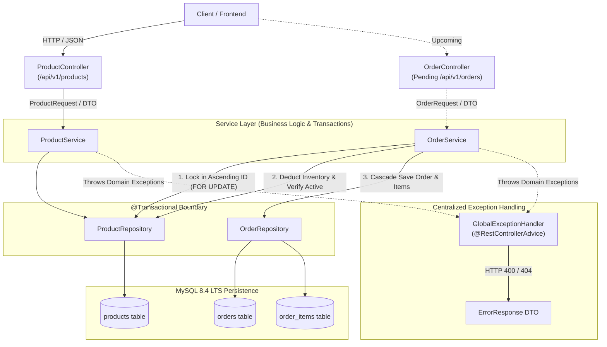
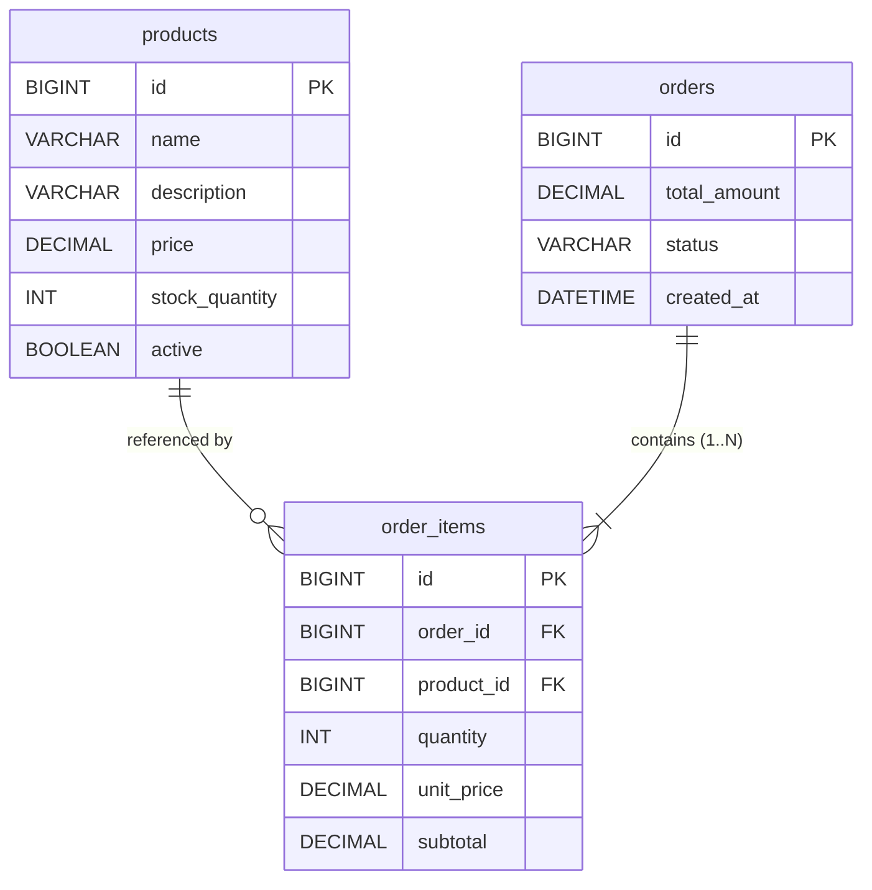

# OrderFlow — E-commerce Order Management System

<p align="center">
  <strong>A transactional, high-concurrency e-commerce order management backend built with Java 21, Spring Boot, and MySQL.</strong>
</p>

<p align="center">
  
  
  
  
  
  
  
</p>

---

## Table of Contents

- [Project Overview](#project-overview)
- [Technology Stack](#technology-stack)
- [Implemented Features](#implemented-features)
  - [1. Product Management](#1-product-management)
  - [2. Order Management & Concurrency Control](#2-order-management--concurrency-control)
- [Architecture](#architecture)
  - [Layered Architecture Breakdown](#layered-architecture-breakdown)
  - [Mermaid Architecture Diagram](#mermaid-architecture-diagram)
- [Database Schema & Configuration](#database-schema--configuration)
  - [Configuration](#configuration)
  - [Entity Relationship & Tables](#entity-relationship--tables)
- [API Documentation](#api-documentation)
  - [Product Endpoints](#product-endpoints)
  - [Request & Response Examples](#request--response-examples)
- [Automated Testing & Verification](#automated-testing--verification)
  - [Test Suite Breakdown (Latest Verified Result: 53 Passing Tests)](#test-suite-breakdown-latest-verified-result-53-passing-tests)
  - [Testing Methodologies](#testing-methodologies)
- [Project Structure](#project-structure)
- [Setup & Installation](#setup--installation)
  - [Prerequisites](#prerequisites)
  - [Database Setup](#database-setup)
  - [Running Locally](#running-locally)
  - [Running Automated Tests](#running-automated-tests)
  - [Building for Production](#building-for-production)
- [Project Status & Roadmap](#project-status--roadmap)
- [Development & Engineering Principles](#development--engineering-principles)

---

## Project Overview

**OrderFlow** is an e-commerce order management backend system built with **Java 21**, **Spring Boot 4.1.2**, and **MySQL 8.4.13** as its relational database. It provides the core functionality for online retail operations, handling product catalog administration, real-time inventory tracking, and transactional checkout workflows.

The system is structured using a standard Spring Boot layered architecture, establishing clear separation of concerns across controllers, services, repositories, domain entities, and data transfer objects (DTOs):
- **ACID Transaction Guarantees**: Complete transactional order placement using Spring `@Transactional`.
- **Pessimistic Write Locking (`SELECT ... FOR UPDATE`)**: Protects the relevant product rows against overselling during concurrent purchase requests.
- **Deadlock Risk Reduction**: Deterministic, ascending product ID lock acquisition reduces the risk of deadlocks when concurrent multi-product orders involve the same items.
- **Decoupled API Contracts**: Request and response Data Transfer Objects (DTOs) prevent entity exposure.
- **Declarative Validation**: Jakarta Bean Validation guarantees input hygiene at the API boundary.
- **Resilient Error Handling**: Centralized exception advice translates domain exceptions into standard HTTP error responses.
- **Automated Testing Suite**: 53 passing tests across unit, web slice, and database integration layers as the latest verified test result.

---

## Technology Stack

| Technology | Purpose | Status |
| :--- | :--- | :--- |
| **Java 21** | Core language (LTS release using modern language features) | In Use |
| **Spring Boot 4.1.2** | Application framework, dependency injection, auto-configuration | In Use |
| **Spring Data JPA & Hibernate** | Object-Relational Mapping (ORM) and repository persistence | In Use |
| **MySQL 8.4.13 LTS** | Relational database persistence | In Use |
| **Maven** | Build automation and dependency management | In Use |
| **Spring Web (MVC)** | REST API routing, request validation, and JSON serialization | In Use |
| **Jakarta Bean Validation** | Declarative payload constraint validation (`jakarta.validation`) | In Use |
| **Global Exception Handling** | Centralized `@RestControllerAdvice` error dispatching | In Use |
| **JUnit 5 & Mockito** | Unit testing, mocking, and behavioral verification | In Use |
| **Spring Boot Test & MockMvc** | Web-layer slice tests and full database integration tests | In Use |
| **Spring Security & JWT** | User authentication, token authorization, and RBAC | Planned |
| **Redis** | In-memory distributed caching and rate limiting | Planned |
| **Docker** | Containerization for reproducible environments | Planned |
| **Apache Kafka** | Asynchronous event streaming for orders and inventory | Future Milestone |

---

## Implemented Features

### 1. Product Management
- **Full CRUD API**: Create, retrieve, update, and delete products under `/api/v1/products`.
- **Data Transfer Objects**:
  - `ProductRequest`: Clean client input contract (`name`, `description`, `price`, `stockQuantity`), preventing unauthorized modification of `id` or `active`.
  - `ProductResponse`: Clean presentation contract returning product state.
- **Declarative Validation**:
  - `@NotBlank` for product name.
  - `@NotNull` and `@Positive` for price (`BigDecimal`).
  - `@NotNull` and `@Min(0)` for stock quantity.
- **Domain Business Rules**:
  - Automatic defaulting of `active = true` for newly created products when unspecified.
  - Server-assigned IDs on creation; existing IDs preserved on updates.
  - Rejection of invalid prices, blank names, or negative inventory.
- **Relational Persistence**: Persisted in MySQL via `ProductRepository` extending `JpaRepository<Product, Long>`.

### 2. Order Management & Concurrency Control
- **Domain Entities & Relationships**:
  - `Order`: Represents the aggregate root (`id`, `totalAmount`, `status`, `createdAt`, `orderItems`).
  - `OrderItem`: Represents line items (`id`, `order_id`, `product_id`, `quantity`, `unitPrice`, `subtotal`).
  - Bidirectional `@OneToMany` mapping with `CascadeType.ALL` and `orphanRemoval = true`.
  - Helper methods `order.addOrderItem()` and `order.removeOrderItem()` maintain referential integrity.
- **Order Lifecycle**: Managed through the `OrderStatus` enum (`PENDING`, `CONFIRMED`, `CANCELLED`, `COMPLETED`).
- **Transactional Order Placement**:
  - `OrderService.placeOrder(OrderRequest)` executes within a single `@Transactional` boundary.
  - Validates that every requested product exists and is active (`Boolean.TRUE.equals(active)`).
  - Verifies available inventory (`stockQuantity >= requestedQuantity`).
  - Automatically decrements product stock upon successful placement.
  - Calculates line subtotals (`unitPrice * quantity`) and order total using immutable `BigDecimal` arithmetic.
  - Client-supplied prices or statuses are ignored; prices are sourced exclusively from persisted `Product` records.
- **Pessimistic Write Locking (`PESSIMISTIC_WRITE`)**:
  - `ProductRepository.findByIdWithPessimisticLock(Long id)` executes `SELECT ... FOR UPDATE`.
  - Secures exclusive row-level locks on the relevant product rows in MySQL, protecting them against overselling during concurrent purchase requests.
- **Ascending Lock Acquisition Order**:
  - Incoming product IDs are sorted and locked strictly in **ascending numerical order** (`$ID_1 < ID_2 < \dots < ID_n$`), reducing deadlock risk when concurrent multi-product orders request overlapping products in different sequences.
- **Strict Input Validation & Duplicate Protection**:
  - `@Positive` and `@NotNull` on `OrderItemRequest.productId`.
  - Rejects duplicate product IDs within a single request with clear validation errors.
  - Rejects null, zero, or negative order quantities.
- **Optimized Eager Retrieval**:
  - `OrderRepository.findByIdWithItems(Long id)` uses `LEFT JOIN FETCH o.orderItems oi LEFT JOIN FETCH oi.product`.
  - Eagerly loads line items and associated product metadata for the retrieved order in a single query, preventing `LazyInitializationException` and avoiding N+1 query overhead during order detail retrieval.
- **Custom Domain Exceptions**:
  - `ProductNotFoundException` (mapped to HTTP 404).
  - `InactiveProductException` (mapped to HTTP 400).
  - `InsufficientStockException` (mapped to HTTP 400).

---

## Architecture

OrderFlow implements a clean, layered architecture ensuring separation of concerns:

```
┌─────────────────────────────────────────────────────────────┐
│                     Client (HTTP / JSON)                    │
└──────────────────────────────┬──────────────────────────────┘
                               │
                               ▼
┌─────────────────────────────────────────────────────────────┐
│                      Controller Layer                       │
│      ProductController  │  HealthController                 │
│      • Handles HTTP requests & REST routing                 │
│      • Validates payloads with @Valid                       │
│      • Transforms Entities <-> DTOs                         │
└──────────────────────────────┬──────────────────────────────┘
                               │
                               ▼
┌─────────────────────────────────────────────────────────────┐
│                       Service Layer                         │
│      ProductService  │  OrderService                        │
│      • Enforces domain validation & business invariants     │
│      • Manages transactional boundaries (@Transactional)    │
│      • Coordinates stock reduction & order creation         │
│      • Enforces ascending lock acquisition to avoid deadlock│
└──────────────────────────────┬──────────────────────────────┘
                               │
                               ▼
┌─────────────────────────────────────────────────────────────┐
│                      Repository Layer                       │
│      ProductRepository  │  OrderRepository                  │
│      • Spring Data JPA abstraction                          │
│      • Pessimistic Locking: SELECT ... FOR UPDATE           │
│      • Eager JOIN FETCH query optimization                  │
└──────────────────────────────┬──────────────────────────────┘
                               │
                               ▼
┌─────────────────────────────────────────────────────────────┐
│                    MySQL 8.4 LTS Database                   │
│      Tables: products  │  orders  │  order_items            │
└─────────────────────────────────────────────────────────────┘
```

### Layered Architecture Breakdown

1. **Controller Layer (`com.orderflow.orderflow.controller`)**: Exposes REST endpoints, validates incoming JSON using Jakarta Bean Validation (`@Valid`), converts DTOs to domain models, and returns standard HTTP status codes.
2. **Service Layer (`com.orderflow.orderflow.service`)**: Encapsulates business logic, transactional boundaries (`@Transactional`), domain validations, and pricing calculations.
3. **Repository Layer (`com.orderflow.orderflow.repository`)**: Interfaces extending `JpaRepository` providing CRUD queries, custom JPQL queries, and database row-level locking.
4. **Model Layer (`com.orderflow.orderflow.model`)**: JPA entities representing core database tables and business aggregates (`Product`, `Order`, `OrderItem`, `OrderStatus`).
5. **DTO Layer (`com.orderflow.orderflow.dto`)**: Strictly separates public API representations from internal database models (`ProductRequest`, `ProductResponse`, `OrderRequest`, `OrderItemRequest`, `OrderResponse`, `OrderItemResponse`, `ErrorResponse`).
6. **Exception Handling Layer (`com.orderflow.orderflow.exception`)**: Central `@RestControllerAdvice` converting exceptions into standardized, client-friendly error structures.

### Mermaid Architecture Diagram



---

## Database Schema & Configuration

### Configuration

Database connection settings are configured in `src/main/resources/application.properties`. Environment variables can be used to externalize credentials:

```properties
spring.application.name=orderflow
server.port=8081

# MySQL Database DataSource
spring.datasource.url=${SPRING_DATASOURCE_URL:jdbc:mysql://localhost:3306/orderflow}
spring.datasource.username=${SPRING_DATASOURCE_USERNAME:root}
spring.datasource.password=${SPRING_DATASOURCE_PASSWORD:your_password}
spring.datasource.driver-class-name=com.mysql.cj.jdbc.Driver

# JPA & Hibernate ORM
spring.jpa.hibernate.ddl-auto=update
spring.jpa.show-sql=true
spring.jpa.properties.hibernate.format_sql=true
```

### Entity Relationship & Tables



1. **`products`**:
   - `id`: Primary key (Auto Increment).
   - `name`: Product title (Non-null).
   - `description`: Detailed description.
   - `price`: Unit price stored as `DECIMAL(38,2)` to avoid floating-point errors.
   - `stock_quantity`: Available inventory count.
   - `active`: Boolean flag indicating if product can be ordered.
2. **`orders`**:
   - `id`: Primary key (Auto Increment).
   - `total_amount`: Total order price (`DECIMAL(38,2)`).
   - `status`: String representation of `OrderStatus` (`PENDING`, `CONFIRMED`, `CANCELLED`, `COMPLETED`).
   - `created_at`: Order placement timestamp.
3. **`order_items`**:
   - `id`: Primary key (Auto Increment).
   - `order_id`: Foreign key referencing `orders.id` (associated items are managed through JPA `CascadeType.ALL` and `orphanRemoval = true`).
   - `product_id`: Foreign key referencing `products.id`.
   - `quantity`: Number of units ordered.
   - `unit_price`: Price per unit locked at the time of purchase.
   - `subtotal`: Calculated total for this line item (`quantity * unit_price`).

---

## API Documentation

### Product Endpoints

| HTTP Verb | Endpoint | Description | Status Codes |
| :--- | :--- | :--- | :--- |
| `GET` | `/api/v1/health` | Application health check | `200 OK` |
| `POST` | `/api/v1/products` | Create a new product | `201 Created`, `400 Bad Request` |
| `GET` | `/api/v1/products` | Retrieve all products | `200 OK` |
| `GET` | `/api/v1/products/{id}` | Retrieve single product by ID | `200 OK`, `404 Not Found` |
| `PUT` | `/api/v1/products/{id}` | Update existing product | `200 OK`, `400 Bad Request`, `404 Not Found` |
| `DELETE` | `/api/v1/products/{id}` | Delete product by ID | `204 No Content`, `404 Not Found` |

> [!NOTE]
> The `OrderController` REST endpoints (e.g., `POST /api/v1/orders`, `GET /api/v1/orders/{id}`) are scheduled for the next milestone. Currently, all order management logic is fully implemented and tested via `OrderService`.

---

### Request & Response Examples

#### 1. Create Product (Valid Request)
- **POST** `/api/v1/products`
- **Request Body**:
```json
{
  "name": "Wireless Mechanical Keyboard",
  "description": "Compact 75% layout with hot-swappable switches",
  "price": 89.99,
  "stockQuantity": 50
}
```
- **Response** (`201 Created`):
```json
{
  "id": 1,
  "name": "Wireless Mechanical Keyboard",
  "description": "Compact 75% layout with hot-swappable switches",
  "price": 89.99,
  "stockQuantity": 50,
  "active": true
}
```

#### 2. Create Product (Validation Failure)
- **POST** `/api/v1/products`
- **Request Body**:
```json
{
  "name": "",
  "description": "Invalid product payload",
  "price": -10.00,
  "stockQuantity": -5
}
```
- **Response** (`400 Bad Request`): Handled by `GlobalExceptionHandler`:
```json
{
  "status": 400,
  "error": "Validation Failed",
  "messages": [
    "name: must not be blank",
    "price: must be greater than 0",
    "stockQuantity: must be greater than or equal to 0"
  ]
}
```

#### 3. Get All Products
- **GET** `/api/v1/products`
- **Response** (`200 OK`):
```json
[
  {
    "id": 1,
    "name": "Wireless Mechanical Keyboard",
    "description": "Compact 75% layout with hot-swappable switches",
    "price": 89.99,
    "stockQuantity": 50,
    "active": true
  }
]
```

#### 4. Update Product
- **PUT** `/api/v1/products/1`
- **Request Body**:
```json
{
  "name": "Wireless Mechanical Keyboard V2",
  "description": "Upgraded with silent switches and PBT keycaps",
  "price": 99.99,
  "stockQuantity": 40
}
```
- **Response** (`200 OK`):
```json
{
  "id": 1,
  "name": "Wireless Mechanical Keyboard V2",
  "description": "Upgraded with silent switches and PBT keycaps",
  "price": 99.99,
  "stockQuantity": 40,
  "active": true
}
```

#### 5. Delete Product
- **DELETE** `/api/v1/products/1`
- **Response** (`204 No Content`): Empty response body.

---

## Automated Testing & Verification

Automated testing is central to OrderFlow. The test suite combines unit tests, web-layer slice tests, and full database integration tests against MySQL. The latest verified test run produced 53 passing tests with 0 failures and 0 errors.

### Test Suite Breakdown (Latest Verified Result: 53 Passing Tests)

| Test Class | Category / Scope | Tests Run | Failures | Errors | Result |
| :--- | :--- | :---: | :---: | :---: | :---: |
| **`ProductControllerTest`** | Web slice tests (`@WebMvcTest`, `MockMvc`) | **10** | 0 | 0 | PASSED |
| **`ProductServiceTest`** | Unit tests for product business logic & validations | **12** | 0 | 0 | PASSED |
| **`OrderDtoTest`** | DTO constraint validation & encapsulation tests | **7** | 0 | 0 | PASSED |
| **`OrderRepositoryTest`** | Data JPA repository tests (save, cascade, findByStatus) | **2** | 0 | 0 | PASSED |
| **`OrderServiceTest`** | Unit tests for order placement, calculations & lock ordering | **13** | 0 | 0 | PASSED |
| **`OrderServiceIntegrationTest`** | Full DB integration tests (transactions, rollback, concurrency) | **4** | 0 | 0 | PASSED |
| **`GlobalExceptionHandlerTest`** | Exception handler mapping & HTTP status verification | **4** | 0 | 0 | PASSED |
| **`OrderflowApplicationTests`** | Spring Boot application context load verification | **1** | 0 | 0 | PASSED |
| **Total** | | **53** | **0** | **0** | **BUILD SUCCESS** |

*Note: Test counts reflect the latest verified test execution (`mvn test`) rather than a permanent guarantee or code coverage percentage.*

### Testing Methodologies

1. **Web Layer Slice Testing (`ProductControllerTest`)**:
   - Uses `@WebMvcTest(ProductController.class)` and `MockMvc` to test controller routing, status codes, and Bean Validation in complete isolation from the database.
2. **Unit Testing with Mockito (`ProductServiceTest`, `OrderServiceTest`)**:
   - Mocks repository calls to test business invariants, stock deduction calculations, BigDecimal accuracy, and exception throwing.
   - Validates that pessimistic locks are requested in strictly ascending product ID order using Mockito's `inOrder` verification.
3. **Database Integration Testing (`OrderServiceIntegrationTest`)**:
   - **Persistence & Cascade**: Verifies that placing an order persists records in `orders` and `order_items` tables and decrements inventory in `products`.
   - **Transaction Rollback**: Orders item 1 (valid) followed by item 2 (insufficient stock). Verifies that when item 2 throws `InsufficientStockException`, item 1's stock reduction is rolled back in MySQL, leaving zero orphaned orders.
   - **Concurrency & Overselling Prevention**: Spawns multiple threads simultaneously attempting to purchase remaining stock. Verifies that pessimistic row locking (`SELECT ... FOR UPDATE`) protects the relevant product rows against overselling, allowing valid requests to succeed while rejecting requests that exceed available inventory.
   - **Eager Retrieval**: Verifies that `getOrderById()` fetches all items and product details via `JOIN FETCH` without throwing `LazyInitializationException`.

---

## Project Structure

```text
orderflow/
├── .mvn/
│   └── wrapper/
│       └── maven-wrapper.properties
├── src/
│   ├── main/
│   │   ├── java/
│   │   │   └── com/orderflow/orderflow/
│   │   │       ├── controller/
│   │   │       │   └── ProductController.java
│   │   │       ├── dto/
│   │   │       │   ├── ErrorResponse.java
│   │   │       │   ├── OrderItemRequest.java
│   │   │       │   ├── OrderItemResponse.java
│   │   │       │   ├── OrderRequest.java
│   │   │       │   ├── OrderResponse.java
│   │   │       │   ├── ProductRequest.java
│   │   │       │   └── ProductResponse.java
│   │   │       ├── exception/
│   │   │       │   ├── GlobalExceptionHandler.java
│   │   │       │   ├── InactiveProductException.java
│   │   │       │   ├── InsufficientStockException.java
│   │   │       │   └── ProductNotFoundException.java
│   │   │       ├── model/
│   │   │       │   ├── Order.java
│   │   │       │   ├── OrderItem.java
│   │   │       │   ├── OrderStatus.java
│   │   │       │   └── Product.java
│   │   │       ├── repository/
│   │   │       │   ├── OrderRepository.java
│   │   │       │   └── ProductRepository.java
│   │   │       ├── service/
│   │   │       │   ├── OrderService.java
│   │   │       │   └── ProductService.java
│   │   │       ├── HealthController.java
│   │   │       └── OrderflowApplication.java
│   │   └── resources/
│   │       └── application.properties
│   └── test/
│       └── java/
│           └── com/orderflow/orderflow/
│               ├── GlobalExceptionHandlerTest.java
│               ├── OrderDtoTest.java
│               ├── OrderflowApplicationTests.java
│               ├── OrderRepositoryTest.java
│               ├── OrderServiceIntegrationTest.java
│               ├── OrderServiceTest.java
│               ├── ProductControllerTest.java
│               └── ProductServiceTest.java
├── mvnw
├── mvnw.cmd
├── pom.xml
└── README.md
```

---

## Setup & Installation

### Prerequisites
- **Java Development Kit (JDK) 21** or higher
- **MySQL Server 8.4 LTS** (or compatible 8.0+)
- **Git**
- Maven is bundled via the included Maven Wrapper (`./mvnw` or `mvnw.cmd`)

### Database Setup

Log into your local MySQL server and create the application database:

```sql
CREATE DATABASE orderflow;
```

Optionally set environment variables for your database credentials:

```bash
# Linux / macOS
export SPRING_DATASOURCE_URL="jdbc:mysql://localhost:3306/orderflow"
export SPRING_DATASOURCE_USERNAME="your_username"
export SPRING_DATASOURCE_PASSWORD="your_password"
```

```powershell
# Windows PowerShell
$env:SPRING_DATASOURCE_URL="jdbc:mysql://localhost:3306/orderflow"
$env:SPRING_DATASOURCE_USERNAME="your_username"
$env:SPRING_DATASOURCE_PASSWORD="your_password"
```

### Running Locally

Run the application with the Maven Wrapper on port **8081**:

```powershell
# Windows PowerShell
.\mvnw.cmd spring-boot:run
```

```bash
# Linux / macOS
./mvnw spring-boot:run
```

Once started, verify the health endpoint:
- **Health Check**: [http://localhost:8081/api/v1/health](http://localhost:8081/api/v1/health)
- **Products API**: [http://localhost:8081/api/v1/products](http://localhost:8081/api/v1/products)

### Running Automated Tests

Execute the complete automated test suite (latest verified run: 53 passing tests):

```powershell
# Windows PowerShell
.\mvnw.cmd test
```

```bash
# Linux / macOS
./mvnw test
```

### Building for Production

Package the application into an executable JAR:

```powershell
# Windows PowerShell
.\mvnw.cmd clean package
```

```bash
# Linux / macOS
./mvnw clean package
```

The compiled JAR will be generated under `target/orderflow-0.0.1-SNAPSHOT.jar`.

---

## Project Status & Roadmap

### Milestones

| Milestone | Scope | Status |
| :--- | :--- | :---: |
| **Phase 1: Foundation** | Spring Boot 4.1.2 setup, Java 21, Health endpoint, server configuration | **Completed** |
| **Phase 2: Product Management** | Product domain model, service business logic, DTOs, full CRUD REST API | **Completed** |
| **Phase 3: Validation & Exception Handling** | Jakarta Bean Validation, `@RestControllerAdvice`, standardized `ErrorResponse` | **Completed** |
| **Phase 4: Database Persistence** | MySQL 8.4 LTS, Spring Data JPA, Hibernate ORM, schema generation | **Completed** |
| **Phase 5: Order Foundation & Entities** | `Order`, `OrderItem`, `OrderStatus` enum, JPA mappings, cascade persistence | **Completed** |
| **Phase 6: Transactional Order Placement** | `@Transactional`, stock validation and deduction, `BigDecimal` calculations | **Completed** |
| **Phase 7: Concurrency & Lock Management** | Pessimistic write locking (`SELECT ... FOR UPDATE`), ascending lock ordering | **Completed** |
| **Phase 8: Automated Testing** | 53 unit, web slice, and integration tests (latest verified result: 53 passing) | **Completed** |
| **Phase 9: Order REST Controller** | `OrderController` endpoints (`POST /api/v1/orders`, `GET /api/v1/orders/{id}`) | **Next Milestone** |
| **Phase 10: Order Management Lifecycle** | Order cancellation workflow, stock restoration, idempotency keys | Planned |
| **Phase 11: Security & Identity** | Spring Security 6, JWT authentication, user ownership of orders | Planned |
| **Phase 12: Production Readiness** | Dockerization, Redis caching, CI/CD pipeline, event-driven streaming | Future Milestone |

---

## Development & Engineering Principles

OrderFlow is developed as a rigorous backend portfolio project emphasizing software engineering fundamentals:
- **ACID Transaction Boundaries**: Understanding isolation levels, transaction propagation, and automated rollback semantics.
- **Handling Concurrency in Databases**: Protecting relevant product records against overselling with row-level pessimistic locks (`SELECT ... FOR UPDATE`) during order placement.
- **Deadlock Mitigation**: Acquiring product locks in ascending ID order to reduce deadlock risk during concurrent multi-product orders.
- **Contract Safety & Decoupling**: Protecting JPA entities from API consumers using clean DTO boundaries and Bean Validation.
- **Precision with Money**: Strictly utilizing `BigDecimal` for currency arithmetic to avoid IEEE 754 floating-point rounding inaccuracies.
- **Comprehensive Verification**: Validating all layers with isolated unit tests and real database integration tests before advancing milestones.

---

<p align="center">
  <em>OrderFlow — Reliable, concurrent, and maintainable backend engineering with Spring Boot & Java 21.</em>
</p>
